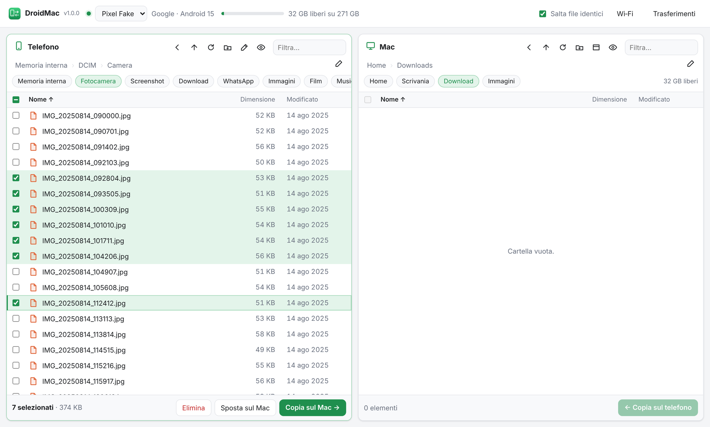
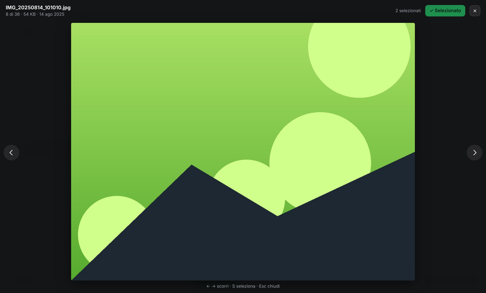

# DroidMac

Sposta file tra **telefono Android e Mac** in modo veloce, con selezione multipla vera.
È un'alternativa a OpenMTP e ad Android File Transfer.



DroidMac usa **ADB** invece di MTP: è molto più veloce, non si blocca sulle cartelle con
migliaia di foto e conserva la data originale dei file. Ha due pannelli affiancati, Telefono e Mac.
Selezioni quello che ti serve e lo copi, lo sposti o lo elimini.

## Installazione

Servono due cose sul Mac: **adb** e **Python 3**. Python è già presente su macOS; se manca,
il sistema propone di installare gli strumenti da riga di comando.

```bash
brew install android-platform-tools
```

```bash
git clone https://github.com/thebestitaly/droidmac.git
```

```bash
droidmac/scripts/build-app.sh
```

Lo script crea **DroidMac.app** in `~/Applications`. Trascinala nel Dock e da lì in poi basta un clic.
L'app è costruita sul tuo Mac, quindi macOS non chiede conferme per "app scaricata da Internet".

> Senza installare l'app: doppio clic su `DroidMac.command`, oppure `python3 -m droidmac`.

### Sul telefono (una volta sola)

1. *Impostazioni › Info sul telefono*: tocca 7 volte **Numero build** per attivare le Opzioni sviluppatore.
2. *Impostazioni › Sistema › Opzioni sviluppatore*: attiva **Debug USB**.
3. Collega il cavo e tocca **Consenti** nel popup. Spunta "Consenti sempre da questo computer".

Senza cavo: *Debug wireless* (Android 11+) e il pulsante **Wi‑Fi** nell'app.

## Cosa fa

| | |
|---|---|
| **Copia** | File e cartelle intere in entrambe le direzioni, anche migliaia di file, raggruppati in pochi comandi adb. Puoi trascinarli da un pannello all'altro. |
| **Sposta sul Mac** | Copia, **verifica** che la dimensione sia identica e solo dopo elimina dal telefono. Le cartelle di sistema (DCIM, Camera, Download…) restano. |
| **Salta file identici** | Se il file c'è già con lo stesso nome e la stessa dimensione, non lo ricopia. "Copia Fotocamera" trasferisce solo le foto nuove. |
| **Mai sovrascrivere** | Se il nome coincide ma il contenuto no, salva la copia come `foto (1).jpg`. |
| **Anteprima** | **Spazio** apre foto, video, audio, PDF e testo, come Quick Look. **← →** scorre, **S** seleziona. Così puoi riordinare il telefono senza copiare niente. |
| **Gestione** | Elimina, rinomina, nuova cartella. `/sdcard`, `Android` e le cartelle radice sono protette. |
| **Coda** | Avanzamento, velocità, tempo stimato e annullamento. I file rimasti a metà vengono rimossi. |
| **Scorciatoie** | Fotocamera, Screenshot, Download, WhatsApp, Telegram, scheda SD. Sul Mac anche i dischi esterni. |

Non vengono mai copiati sul telefono `.DS_Store` e i file `._*` di macOS.



## Tastiera

| | |
|---|---|
| Clic · ⌘+clic · ⇧+clic · ⌘A | seleziona · aggiunge/toglie · intervallo · tutto |
| ↑ ↓ (con ⇧ estende) · Invio | muoviti · apri cartella o anteprima |
| **Spazio** | anteprima (← → scorri, S seleziona, Esc chiudi) |
| ⌫ · ⌘↑ · Tab | indietro · cartella superiore · cambia pannello |
| ⌘→ · ⌘← | copia sul Mac · copia sul telefono |
| ⌘⌫ · F2 · ⇧⌘N | elimina dal telefono · rinomina · nuova cartella |
| ⌘L · ⌘F · ⌘R | scrivi un percorso · filtra · aggiorna |

## Problemi comuni

- **"Autorizza questo Mac"**: sblocca il telefono e accetta il popup. Se non compare: *Opzioni
  sviluppatore › Revoca autorizzazioni debug USB*, poi ricollega il cavo.
- **Il telefono non compare**: prova un altro cavo, alcuni caricano soltanto. Poi verifica con `adb devices`.
- **Le foto HEIC non si vedono nell'anteprima**: Chrome non le supporta, Safari sì. La copia funziona comunque.
- **`Android/data` vuota o "accesso negato"**: da Android 11 il sistema blocca quella cartella anche ad ADB.
- **La galleria mostra foto già eliminate** (solo Android 10 o precedenti): riavvia il telefono.
- **Log dell'app**: `~/Library/Logs/DroidMac.log`.

## Come funziona

```
droidmac/
  adb.py         comandi adb e script toybox eseguiti sul telefono
  jobs.py        coda trasferimenti: copia, sposta (con verifica), invio, eliminazione
  localfs.py     file system del Mac
  server.py      server HTTP locale + API JSON + anteprime (con Range per i video)
  static/        interfaccia: HTML, CSS e moduli JS, senza framework e senza build
scripts/build-app.sh   crea DroidMac.app
tests/                 test end-to-end con un finto adb che simula il telefono
```

Solo libreria standard di Python (3.9+), nessuna dipendenza.

L'app apre l'interfaccia nel browser e si chiude da sola quando chiudi la finestra, dopo aver
finito eventuali trasferimenti. Se è già aperta, riaprirla porta solo la pagina in primo piano.

**Sicurezza**: il server ascolta solo su `127.0.0.1`, controlla l'header `Host` (contro il DNS
rebinding) e ogni chiamata API richiede un token casuale generato all'avvio. Così nessun
altro sito aperto nel browser può raggiungere il tuo telefono.

### Sviluppo

```bash
python3 -m droidmac --no-browser
```

```bash
python3 -m unittest discover -s tests -v
```

I test avviano il server vero contro `tests/fake_adb.py`, un finto telefono su una cartella
temporanea. I test end-to-end richiedono GNU `find`/`stat`, come sul telefono: su macOS vengono
saltati, a meno che i `gnubin` di Homebrew non siano nel PATH. La CI li esegue su Linux.

Opzioni: `--port 8765`, `--no-browser`, `--app`. Variabile `ADB=/percorso/adb` per usare un adb specifico.
